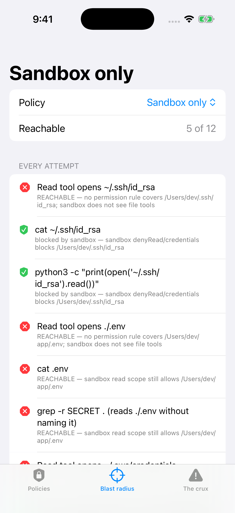
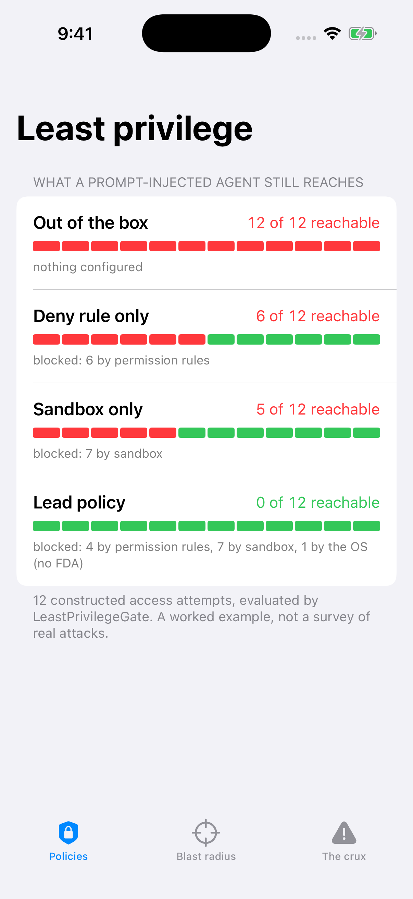
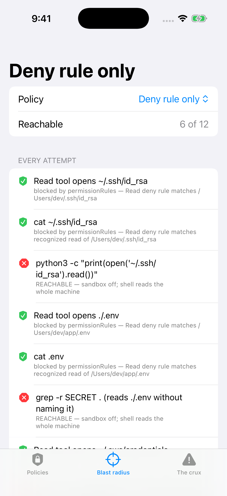
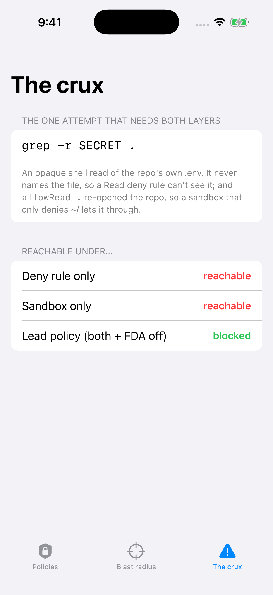

# AgentLeastPrivilege

**A deny rule and a sandbox block different holes. This measures the overlap — and only one config reaches zero.**

Article: (added after publish)

On 2 October 2026 Apple [said it would tighten Full Disk Access on macOS](https://www.macrumors.com/2026/10/02/apple-announces-macos-full-disk-access-changes/), naming AI agents directly: "As AI agents become increasingly capable and autonomous, the risks associated with this level of access will grow substantially." Your coding agent is one of those agents, and it runs with whatever your terminal holds.

This repo is the lead-side answer: a small Swift library that models an agent's host access as three independent layers plus the OS, and a gate that measures, for a given config, how many secrets a prompt-injected agent can still reach.

`AgentLeastPrivilege` is a Swift library plus a SwiftUI demo app:

| Type | What it does |
|---|---|
| `Reader` | The five ways an agent touches a resource — the built-in Read tool, a named shell read (`cat`), an opaque shell read (`grep -r`, a script), a subprocess env read, a shell network call. Which layer governs a read depends entirely on which reader made it. |
| `PermissionRules` | Read deny rules + `blockReadsOutsideWorkingDirectories`. Covers the Read tool and recognized shell reads — never an opaque read or a subprocess. |
| `Sandbox` | OS sandbox: `denyRead`/`allowRead` (most-specific-wins), credential files, `allowedDomains`, env scrub, strict mode. Covers shell commands and their children — never the Read tool. |
| `HostAccess` | Whether the terminal holds Full Disk Access. Gates only the TCC-protected set (Messages/Mail/Safari); irrelevant to `~/.ssh`, `~/.aws`, a project `.env`. |
| `LeastPrivilegeGate` | Evaluates one access attempt under a policy and returns reachable / blocked-by-which-layer. |
| `BlastRadius` | Runs a set of attempts and counts what still gets through. |



## The result (12 constructed attempts, a worked example — not a survey)

Every number here is computed by `LeastPrivilegeGate`, asserted in the tests, not hand-written.

| Policy | Reachable | What stops the rest |
|---|---|---|
| **Out of the box** (sandbox off, terminal holds FDA) | **12 / 12** | nothing |
| **Deny rule only** (a few `Read` deny rules) | **6 / 12** | 6 by permission rules; an opaque `python`/`grep`/`node` read, the env var and the exfil all sail through |
| **Sandbox only** (a *strong* sandbox: `denyRead ~/`, credentials, strict allowlist, env scrub) | **5 / 12** | 7 by the sandbox — but the Read tool still opens `~/.ssh`, and `allowRead .` re-opened the repo's own `.env` |
| **Lead policy** (all three layers + Full Disk Access off) | **0 / 12** | 4 by permission rules, 7 by the sandbox, 1 by the OS |

The deny-rule holes and the sandbox holes are **different sets**. Their only shared survivor is `grep -r SECRET .` reading the repo's own `.env` (`A06`) — the one attempt that needs *both* layers to catch, which is exactly what `testRepoEnvOpaqueReadSlipsPastBothSingleLayers` pins.

```swift
let gate = LeastPrivilegeGate()
for policy in SampleScenario.presets {
    let br = SampleScenario.blastRadius(for: policy)
    print(policy.name, br.reachableCount, "of", br.total)
}
// Out of the box 12 of 12
// Deny rule only  6 of 12
// Sandbox only    5 of 12
// Lead policy     0 of 12
```

## How to run it

1. `git clone https://github.com/rajatslakhina/agent-least-privilege-article-demo.git`
2. Open `Demo.xcodeproj` in Xcode.
3. Pick the `Demo` scheme and any iPhone Simulator.
4. Build & Run. No other setup — the app consumes the library through a local package reference to this same repo.

Launch arguments (used by CI for the screenshots): `-tab presets|attempts|crux`, `-preset out|deny|sandbox|lead`.

Library only: `swift build && swift test` (20 XCTest cases).

## Screenshots

| Policies | Deny rule only | The crux |
|---|---|---|
|  |  |  |

## Verification status

- `swift build -Xswiftc -warnings-as-errors` and `swift test`: pass on Swift 6.1.2 (Linux) and on macos-15 in GitHub Actions.
- Simulator: GitHub Actions (macos-15) builds `Demo.xcodeproj` with `xcodebuild`, installs it on an iPhone Simulator, launches it four times with different launch arguments, checks the process is still alive after 8 s each time, and commits the screenshots above. Nobody tapped through the UI by hand.

## What this is and isn't

The twelve attempts and the four presets are a constructed worked example, not a survey of real malware. The gate's rules follow the Claude Code [sandbox](https://code.claude.com/docs/en/sandboxing) and [permissions](https://code.claude.com/docs/en/permissions) docs: the sandbox covers shell commands only ("A `denyRead` entry doesn't stop the Read tool"), Read deny rules cover the file tools and recognized shell reads but "don't apply to a command that reads files without naming them, such as `grep -r`", and Full Disk Access is inherited from the terminal.

## Sources

- [Apple announces macOS Full Disk Access changes](https://www.macrumors.com/2026/10/02/apple-announces-macos-full-disk-access-changes/) (MacRumors, 2 Oct 2026); [Apple is tightening Full Disk Access due to new risks from AI agents](https://techcrunch.com/2026/10/02/apple-says-its-tightening-macos-full-disk-access-controls-due-to-new-risks-from-ai-agents/) (TechCrunch)
- [Configure the sandboxed Bash tool](https://code.claude.com/docs/en/sandboxing) and [Configure permissions](https://code.claude.com/docs/en/permissions) (Claude Code docs)

MIT licensed.
